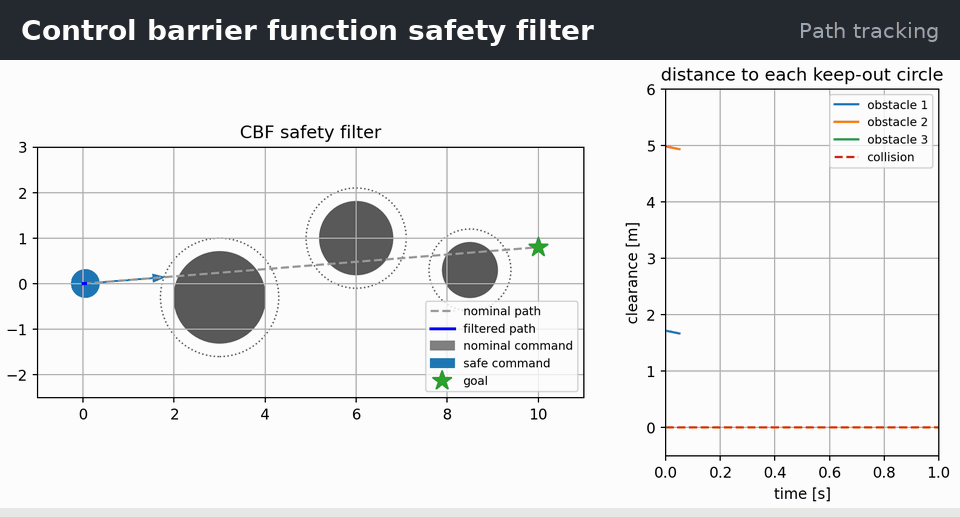
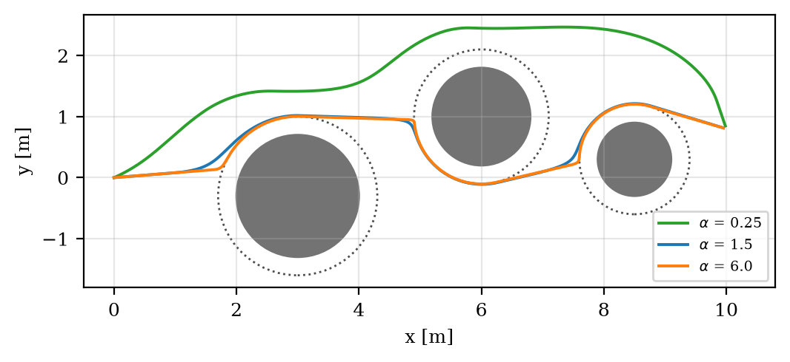

# Control Barrier Function Safety Filter

[](https://github.com/robofan45/cbf-safety-filter/actions/workflows/ci.yml)

[](LICENSE)
[](docs/report.pdf)

A control barrier function (CBF) safety filter that changes a go-to-goal command as little as possible so the robot never enters an obstacle. An exact closed-form solver for the 2D quadratic program, and a proof that the sampled filter keeps the whole path safe, not only its samples.

<p align="center">
  
</p>

## Results

| Measure | Result |
|---|---|
| Nominal controller alone | drives through all 3 obstacles |
| With the filter: time to goal, closest approach | 19.15 s, 4.3 mm, never inside |
| Already-safe commands changed by the filter | 0 of 114 |
| Barrier rate 0.25 → 6 s⁻¹: time to goal | 25.8 s → 18.25 s |
| Exact QP solver against SciPy SLSQP (1000 problems) | agree to 5 × 10⁻⁸, 59 µs vs 178 µs |

Every number above is measured by [`scripts/make_figures.py`](scripts/make_figures.py), which also writes [`docs/results.json`](docs/results.json) and the figures of the report.

## How it works

Each obstacle gives a barrier $h_i(p)=\lVert p-c_i\rVert^2-R_i^2$ that is positive while the robot is clear of it. Every step the filter solves

```math
u^*=\arg\min_u \lVert u-u_{\text{nom}}\rVert^2 \quad\text{subject to}\quad 2(p-c_i)^\top u \ge -\alpha\,h_i(p)\ \ \text{for all } i,
```

so a barrier may shrink, but more and more slowly as it nears zero. With a two-dimensional command, the solution is the nominal command, its projection onto one constraint line, or a corner of two, so the solver simply checks those candidates. Because each $h_i$ is convex, the CBF condition also bounds the barrier along the whole straight segment travelled in a step: $h_i(p+s\,u\,\Delta t)\ge(1-s\,\alpha\Delta t)\,h_i(p)>0$.

<p align="center">
  <br>
  <em>Paths for three barrier rates: a small rate reacts early and keeps far away; a large one passes within a tenth of a millimetre.</em>
</p>

## Quick start

```bash
git clone https://github.com/robofan45/cbf-safety-filter.git
cd cbf-safety-filter
python -m pip install -e .
python -m cbf_safety_filter          # runs the animated demo
```

Requires Python 3.11 or newer; the only dependencies are NumPy and Matplotlib.

## Tests and reproducibility

```bash
python -m pip install -r requirements-dev.txt   # pinned versions, as in CI
pytest                                          # 6 tests
ruff check . && mypy src                        # lint and type checks
python scripts/make_figures.py                  # regenerate docs/figures and docs/results.json
```

CI runs the tests, Ruff and mypy on Linux, macOS and Windows with Python 3.13 and 3.14.

## Report

**Control Barrier Function Safety Filters for Mobile Robots: An Exact Discrete-Time Guarantee and the Role of the Barrier Rate** — an IEEE-style technical report (8 pages) covering the problem, the method, the implementation, the experiments and their limitations, with a full bibliography.

- [`docs/report.pdf`](docs/report.pdf) — read it on GitHub
- [`docs/report.docx`](docs/report.docx) — Word source, with native equations

## Repository layout

```text
cbf-safety-filter/
├── src/cbf_safety_filter/    the algorithm and the animated demo
├── tests/                    pytest suite
├── scripts/make_figures.py   figures and numbers of the report
├── docs/                     report (PDF and Word), figures, results.json
├── assets/demo.gif           the animation above
└── pyproject.toml            package metadata
```

## Citation

If you use this code, please cite it. GitHub's **Cite this repository** button reads [`CITATION.cff`](CITATION.cff); in BibTeX:

```bibtex
@software{trivedi2026cbf,
  author = {Trivedi, Mahim},
  title  = {Control Barrier Function Safety Filter},
  year   = {2026},
  url    = {https://github.com/robofan45/cbf-safety-filter}
}
```

## Related projects

This project is one of seven standalone algorithm projects from the [Python Robotics Projects](https://github.com/robofan45/Python-Robotics-Projects) collection:

- [MPPI Control for Car-Like Robots](https://github.com/robofan45/mppi-control)
- [iLQR Trajectory Optimization](https://github.com/robofan45/ilqr-trajectory-optimization)
- [Augmented Monte Carlo Localization](https://github.com/robofan45/monte-carlo-localization)
- [Interacting Multiple Model (IMM) Filter](https://github.com/robofan45/imm-filter)
- [Multi-Object Tracking](https://github.com/robofan45/multi-object-tracking)
- [ORCA: Optimal Reciprocal Collision Avoidance](https://github.com/robofan45/orca-collision-avoidance)

## License

[MIT](LICENSE) © 2026 Mahim Trivedi. The project grew out of [PythonRobotics](https://github.com/AtsushiSakai/PythonRobotics) by Atsushi Sakai and contributors, also MIT-licensed.
